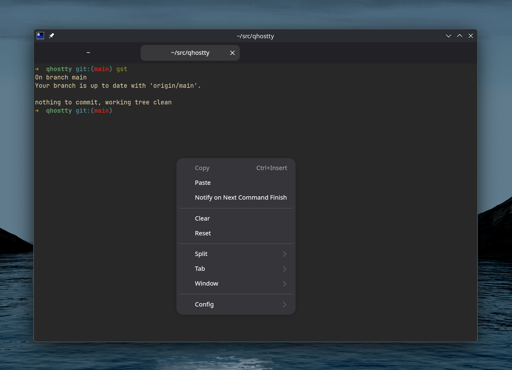
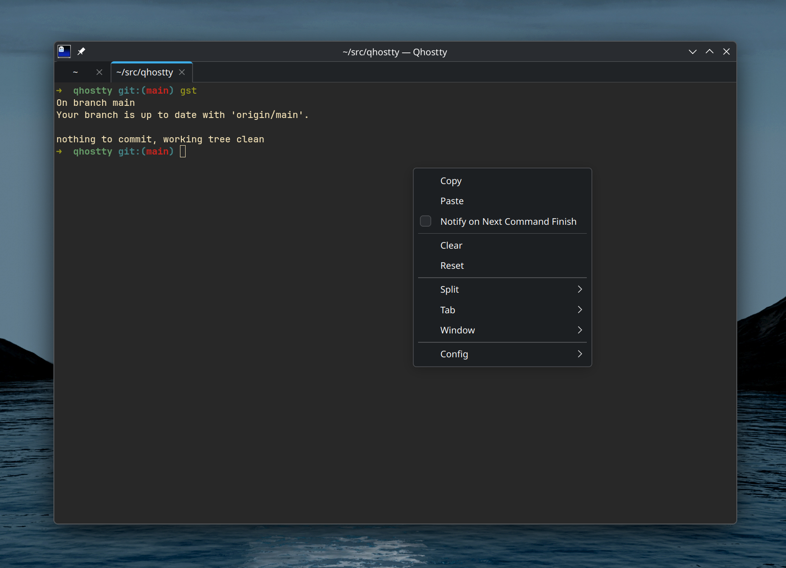

# Qhostty

Qhostty is an experimental native Qt 6 frontend for the [Ghostty](https://ghostty.org/) terminal core. It targets KDE Plasma on Linux and does not use GTK or libadwaita at runtime.

## GTK vs Qt on KDE Plasma

The terminal configuration and content are the same. Only the Linux frontend changes. Select an image to view it at full size.

<table>
  <tr>
    <th>Ghostty · GTK</th>
    <th>Qhostty · Qt 6</th>
  </tr>
  <tr>
    <td><a href="/docs/screenshots/ghostty-gtk.png"></a></td>
    <td><a href="/docs/screenshots/qhostty-qt.png"></a></td>
  </tr>
</table>

Qhostty currently provides:

- Ghostty terminal, PTY, font, configuration, and OpenGL rendering
- Native Qt windows, detachable tabs, nested splits, search, and title UI
- Keyboard, IME, mouse, smooth scrolling, focus, both clipboards, DPI, and resize handling
- Single-instance activation with working-directory and command forwarding
- `qhostty +new-window` and `qhostty +new-tab` open a window or a tab in the running instance
- Drag and drop of text and files, with paste protection
- Drag tabs between windows or out to a new window, and drag splits with
  the `drag-handle` grip to a new position, also in other windows
- Dimmed unfocused splits (`unfocused-split-opacity`, `unfocused-split-fill`) and `split-divider-color`
- `window-theme` (`light` and `dark` force the color scheme, with Qt 6.8 or newer), `window-decoration = none`, `gtk-tabs-location`, and `gtk-wide-tabs`
- `class` (Wayland app ID, X11 class, D-Bus name, and a separate instance per class) and `x11-instance-name`
- Resize overlay with the grid size (`resize-overlay`, `resize-overlay-position`, `resize-overlay-duration`)
- Start-up window state: `maximize`, `fullscreen`, `title`, and `window-new-tab-position`
- `app-notifications` for clipboard copies and configuration reloads, and a dialog for configuration errors
- All `bell-features`: system beep, audio (`bell-audio-path`, `bell-audio-volume`, needs Qt Multimedia), attention, title, and border
- Per-terminal systemd scopes (`linux-cgroup`), as in GTK Ghostty. The memory killer ends only the terminal that uses too much memory, not the whole app. `linux-cgroup = single-instance` (the default) is on, because Qhostty is always single-instance
- `background-opacity`, `background-blur`, and `toggle_background_opacity`. Blur goes through KWindowSystem, which Qt styles such as Kvantum also use. Without KWindowSystem, Qhostty uses the `ext-background-effect-v1` Wayland protocol or the KDE blur property on X11
- A persistent quick terminal with Plasma Wayland and X11 integration
- Global shortcuts for Ghostty `global:` bindings: KGlobalAccel on KDE, and the XDG desktop portal on other desktops, like GTK Ghostty
- A searchable command palette and an OpenGL terminal inspector
- Per-surface readonly, key-state, progress, scrollbar, child-exit, and renderer-health UI
- Command-finished notifications, desktop notifications, URLs, terminal export, and close confirmation
- Notifications with a "Show Terminal" action that focuses the terminal, closed when you focus it
- Activity and silence monitoring per terminal, from the context menu
- Screen reader support: the terminal text, cursor and selection
- KDE web shortcuts for the selected text in the context menu (with KIO)
- A settings window (context menu "Config → Settings…" or `qhostty +settings`). The build generates the list of options from Ghostty's `Config.zig`, so new options appear after each upstream rebase. Saving changes only the edited lines of the config file and checks the result with libghostty first. Themes have a picker with color previews, fonts a monospace font list, keybinds a table with a key recorder, and the palette a color grid
- Plasma launcher metadata, AppStream metadata, icons, and a Dolphin service action
- Translated UI (German). The UI follows the system locale

## What Qt replaces

GTK4 becomes Qt 6 Widgets: `QOpenGLWidget` for the terminal surface, `QSplitter` for splits, `QTabBar` for tabs, `QMessageBox` for dialogs.

Ghostty renders each terminal on its own thread, as it does for GTK. The Qt terminal surface imports each frame as a DMABUF through EGL. If the import fails, Ghostty sends the frames in CPU memory.

libadwaita is dropped rather than reimplemented. Its widgets become plain Qt ones, and its styling role falls to the desktop's own Qt style, which is Breeze under Plasma. That is why Qhostty looks native on KDE without depending on anything from KDE.

The optional KDE Frameworks packages cover only what Qt has no portable API for: quick-terminal placement and layering (LayerShellQt), the quick-terminal slide effect, background blur, and X11 window state (KF6WindowSystem), and global shortcuts (KF6GlobalAccel). Kirigami is not used.

## Build

Requirements: Zig 0.17, CMake 3.25 or newer, Ninja, Qt 6.5 or newer with Core, DBus, Gui, Network, Widgets, OpenGL, OpenGLWidgets, and the Linguist tools, Fontconfig, xkbcommon and xkbcommon-x11, libwayland-client, libxcb, a C++20 compiler, EGL, and OpenGL 4.3.

LayerShellQt, KF6WindowSystem, KF6GlobalAccel, and KF6KIO are optional at build time. They enable exact Plasma quick-terminal placement, KWin effects, KDE global shortcuts, and web shortcuts. Without KF6WindowSystem, only X11 windows get background blur. `QHOSTTY_GENERIC_WAYLAND_BLUR` (ON by default) adds blur through `ext-background-effect-v1` on other Wayland compositors. It needs wayland-scanner and the Qt GUI private headers, so such a build works only with the exact Qt version it was built with. Nix rebuilds against the exact Qt version and keeps it on. The Arch package turns it off, because Arch rebuilds Qt without rebuilding its dependants. Everything else uses only public Qt API.

```sh
cmake -S qt -B build/qt -G Ninja \
  -DCMAKE_BUILD_TYPE=Debug \
  -DBUILD_TESTING=ON
cmake --build build/qt --parallel
build/qt/qhostty +version
build/qt/qhostty
```

For a portable release build:

```sh
cmake -S qt -B build/qt-release -G Ninja \
  -DCMAKE_BUILD_TYPE=Release \
  -DQHOSTTY_GHOSTTY_OPTIMIZE=ReleaseFast \
  -DQHOSTTY_GHOSTTY_CPU=baseline
cmake --build build/qt-release --parallel
```

Install into a staging directory:

```sh
DESTDIR="$PWD/pkgroot" cmake --install build/qt-release --prefix /usr
```

The installed executable uses a private `libghostty.so` under `lib/qhostty`.

### Translations

The UI translations are in `qt/translations`. To add a language, add `qhostty_<lang>.ts` to `TS_FILES` in `qt/CMakeLists.txt`, then run `cmake --build build/qt --target update_translations` and translate the file with Qt Linguist.

## Packages

Arch Linux:

```sh
cd packaging/arch
makepkg -si
```

The package needs `zig` 0.17 or newer. It uses the shell integration and terminfo from `ghostty-shell-integration` and `ghostty-terminfo`.

NixOS:

```sh
nix build .#qhostty
nix run .#qhostty
```

The flake also has an overlay, `overlays.qhostty`, and `nix develop` gives the Qt build dependencies. The package uses the terminfo and shell integration of the `ghostty` package from nixpkgs.

## Background service

Qhostty can run as a systemd user service, like GTK Ghostty. The service starts without a window. Launchers then open windows through D-Bus activation, which is much faster than starting a new process.

```sh
systemctl --user enable --now app-io.github.dr460nf1r3.qhostty.service
```

On NixOS, add the package to `systemd.packages` and `services.dbus.packages`.

Set `quit-after-last-window-closed = false` to keep the service running when you close the last window. `systemctl --user reload app-io.github.dr460nf1r3.qhostty.service` reloads the configuration.

## Validation

```sh
ctest --test-dir build/qt --output-on-failure
! ldd build/qt/qhostty | grep -E 'libgtk|libadwaita'
```

A Plasma Wayland smoke test must cover shell rendering, keyboard shortcuts, IME preedit and commit, selection, both clipboards, mouse-reporting applications, scrolling, tabs, nested splits, window creation, configuration reload, 100% and fractional scaling, and clean shutdown.

## Platform limits

- Plasma Wayland is the primary target. Plasma X11 receives build and startup smoke coverage.
- Exact Wayland quick-terminal placement and layering require LayerShellQt. Without it, Qhostty uses a normal frameless tool window because Wayland clients cannot choose their own global position.
- Global shortcuts need KGlobalAccel on KDE, or a desktop portal with the GlobalShortcuts interface elsewhere. The desktop may ask you to approve them.
- Single-instance forwarding supports working directory, title, font size, command, initial input, wait behavior, and `-e` command arguments. Arbitrary per-window Ghostty CLI configuration is not replayed in the running process.
- `window-titlebar-background`, `window-titlebar-foreground`, `window-title-font-family`, `window-subtitle`, and the `gtk-titlebar*` options style the GTK header bar. With server-side decorations, the desktop draws the title bar, so they have no effect.
- Secure keyboard entry has no reliable Linux equivalent. Structural undo/redo and built-in update checks are reported as unsupported and omitted from the command palette.
- Floating and activation requests remain subject to the Wayland compositor's focus and stacking policy.
- The package temporarily reuses Ghostty's icon and depends on Ghostty terminfo and shell-integration packages.
- NVIDIA, ibus, fcitx, CJK input, and 200% scaling still need broader manual hardware coverage.

See [PLAN.md](/PLAN.md) for the roadmap. Qhostty is independent from the official Ghostty project and uses the [MIT license](/LICENSE).
